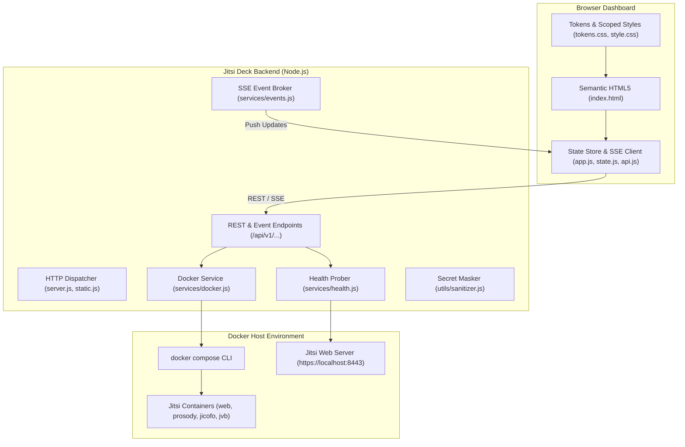

# Jitsi Deck 🎥

[](https://github.com/higherkey/jitsi-deck/actions/workflows/ci.yml)
[](LICENSE)
[](https://nodejs.org/)
[](package.json)
[](CONTRIBUTING.md)

A lightweight, zero-dependency, open-source Web Dashboard and Lifecycle Controller for [Jitsi Meet](https://jitsi.org/) Docker environments.

---

## Features

- 🟢 **Live Telemetry & Status:** Probes local HTTPS endpoints and container states in real time.
- ⏯️ **Full Fleet & Individual Controls:** Start, stop, or restart the entire Jitsi stack, or target individual microservices (`web`, `prosody`, `jicofo`, `jvb`).
- 📋 **Integrated Log Console:** View real-time logs across all services or filter down to a single container with customizable line limits.
- 🔒 **Security First & Secret Masking:** Built-in sanitizer prevents sensitive tokens or passwords (`*_PASSWORD`, `*_SECRET`) from leaking in API responses or UI terminals.
- ⚡ **Zero Runtime Bloat:** Built purely on the Node.js standard library (`node:http`, `node:child_process`, `node:test`). No giant dependency trees or container overhead.
- 🎨 **Modular UI Architecture:** Accessible, semantic HTML5, fluid responsive breakpoints, strict zero inline styles, zero `!important`, and Cumulative Layout Shift (CLS) prevention.

---

## Architecture



---

## Quickstart

### 1. Prerequisites
- [Node.js](https://nodejs.org/) >= 20.0.0
- Docker and Docker Compose running your Jitsi Meet stack

### 2. Installation
Clone the repository into your Jitsi environment or alongside it:

```bash
git clone https://github.com/higherkey/jitsi-deck.git
cd jitsi-deck
```

### 3. Launching
Start Jitsi Deck pointing to your Jitsi Meet directory:

```bash
# Optional: Set JITSI_DIR if running from outside the Jitsi folder
# export JITSI_DIR="/path/to/docker-jitsi-meet"

npm start
```

Open your browser to:
👉 **http://localhost:3000**

---

## Configuration Reference

Jitsi Deck can be configured via environment variables:

| Variable | Default | Description |
|---|---|---|
| `PORT` | `3000` | HTTP port for the dashboard web interface. |
| `HOST` | `0.0.0.0` | Host interface to bind to. |
| `JITSI_DIR` | `../` | Path to the directory containing your Jitsi `docker-compose.yml`. |
| `HTTPS_URL` | `https://localhost:8443` | The public or local HTTPS meeting endpoint to health-check. |
| `POLL_INTERVAL` | `5000` | Background health-check ping frequency in milliseconds. |

---

## API Reference (v1)

All error responses strictly adhere to [RFC 7807 Problem Details](https://tools.ietf.org/html/rfc7807).

- `GET /api/v1/status`: Returns container status, endpoint health, and ping latency.
- `POST /api/v1/services/start`: Starts all Jitsi containers (`docker compose up -d`).
- `POST /api/v1/services/stop`: Stops all Jitsi containers (`docker compose down`).
- `POST /api/v1/services/restart`: Restarts all Jitsi containers (`docker compose restart`).
- `POST /api/v1/services/:name/restart`: Restarts an individual service (`web`, `prosody`, `jicofo`, `jvb`).
- `GET /api/v1/logs?service=web&tail=100`: Fetches sanitized logs.
- `GET /api/v1/events`: Server-Sent Events (SSE) stream for real-time state broadcasts.

---

## Development & Testing

Run unit and integration tests using the native Node.js test runner:

```bash
npm test
```

---

## License

[MIT License](LICENSE) © 2026 higherkey
